# IntelliClass AI: Course Space Management & Real-Time Classroom Architecture

**Design Direction:** Treat a Course Space like a ChatGPT Project: one persistent workspace containing its instructional roadmaps, source materials, student rosters, scheduled classes, and real-time live teaching sessions. Keep the management areas separate, but make class creation, live teaching, and curriculum orchestration directly accessible from the workspace.

The central rule is:

- **Roadmaps define what should be taught.**
- **Materials provide what teaching is based on.**
- **Classes record when and how teaching happens.**
- **Students define who can participate.**
- **Course Space brings everything together.**

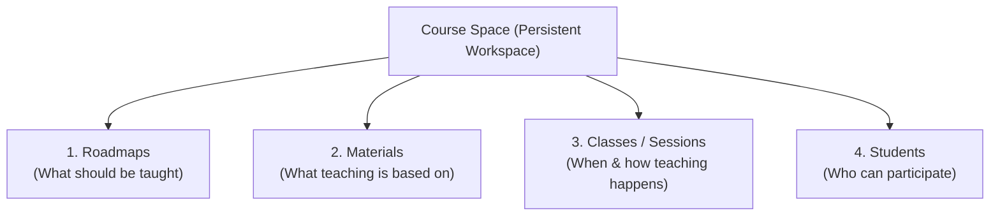

---

# PART I: Real-Time Engine & Monorepo Architecture

IntelliClass AI integrates a polyglot monorepo comprising a Next.js 16 WebGL frontend, a Google Gemini Live bidirectional WebSocket audio engine, a LiveKit WebRTC SFU, a FastAPI PDF visual RAG engine, and a Supabase PostgreSQL backend.

## 1. System Topology & Service Boundaries

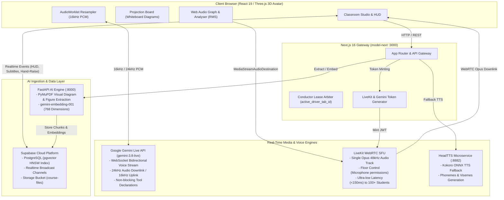

---

## 2. Conductor Audio Bridge & Media Transport Flow

To broadcast Gemini Live audio to 100+ students without per-student Gemini socket costs, the Conductor (Lecturer) browser bridges the Web Audio graph directly into LiveKit via a `MediaStreamAudioDestinationNode`.

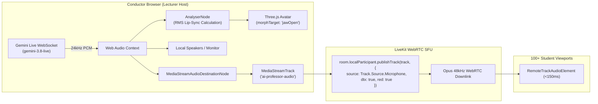

---

## 3. Non-Blocking Pedagogical Tools (`liveTools.ts`)

Gemini Live utilizes non-blocking tool calls (`FunctionResponseScheduling.WHEN_IDLE`) to drive the visual classroom stage in parallel with conversational lecturing:

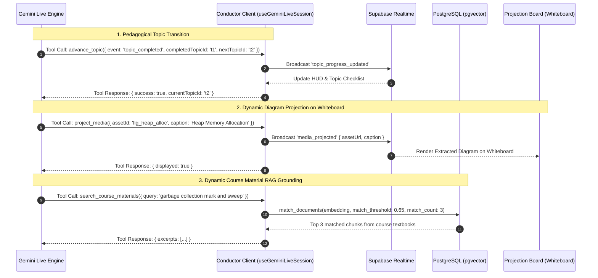

---

## 4. Single-Speaker Microphone Floor-Control Protocol

To prevent multiple students from speaking into Gemini Live simultaneously:

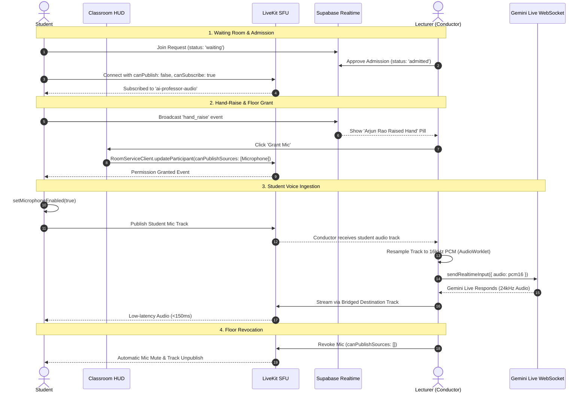

---

## 5. Conductor Lease Arbitration & Multi-Tab Protection

To prevent multiple tabs or windows from opening competing Gemini Live WebSockets for the same classroom:

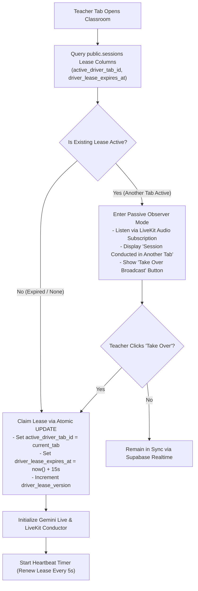

---

## 6. Multimodal Materials & Visual Asset Ingestion Pipeline

Uploaded materials undergo dual-stream processing to generate both text embeddings for semantic search and visual diagram assets for live whiteboard projection.

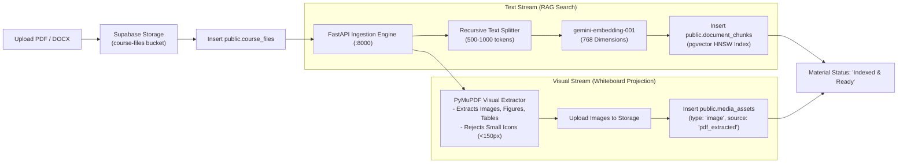

---

# PART II: Course Space Management & UX Architecture

## 7. ChatGPT UX Patterns to Adopt

| ChatGPT Pattern | Course Space Adaptation |
| :--- | :--- |
| **Projects in the sidebar** | Course Space switcher in the persistent sidebar |
| **Project name, icon and color** | Course identity, subject code, and visual badge |
| **Files and project sources** | Reusable materials library (PDFs, docs, extracted diagrams) |
| **Project instructions** | Course teaching instructions, tone, difficulty, constraints |
| **Chats sharing project context** | AI teaching assistant sharing full course and syllabus context |
| **Save responses as project sources** | Save auto-generated class notes as reusable course materials |
| **Shared projects and collaborators** | Student invitations, join requests, and enrollment roster |
| **Search across projects and files** | Global search across course spaces, materials, and past classes |

### Supplementary Patterns
- **Persistent Sidebar:** Fast switching between course spaces.
- **Contextual Actions:** Create, edit, share, and manage from the relevant screen.
- **Global Search (`Ctrl + K`):** Instant lookup across course spaces, files, and classes.
- **Progressive Disclosure:** Keep advanced configurations inside dialogs or drawers.

---

## 8. Information Architecture & Navigation

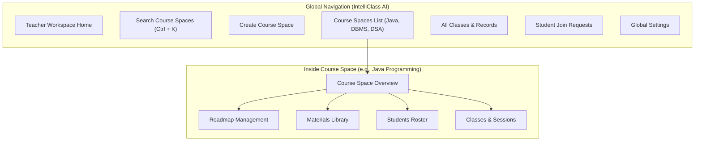

### Visual Workspace Wireframe

```
┌────────────────────────────────────────────────────────────────────────────────────────┐
│  IntelliClass AI  │  Java Programming (CS-101)                 🔍 Search (Ctrl+K)   ⚙️  │
├───────────────────┴────────────────────────────────────────────────────────────────────┤
│  [ Course Space ]   [ Roadmap Management ]   [ Materials ]   [ Students ]   [ Classes ]│
├────────────────────────────────────────────────────────────────────────────────────────┤
│  📘 Course Space: Java Programming Fundamentals                                       │
│  Active • Lecturer Workspace • Manage course, review activity, and launch a class     │
├────────────────────────────────────────────────────────────────────────────────────────┤
│  📊 METRICS SNAPSHOT                                                                   │
│  ┌──────────────────┐ ┌──────────────────┐ ┌──────────────────┐ ┌───────────────────┐  │
│  │ 12 Students      │ │ 8 Completed      │ │ 5 Roadmap Topics │ │ 14 Materials      │  │
│  │ Active Enrolled  │ │ Classes          │ │ 14 Objectives    │ │ Indexed Sources   │  │
│  └──────────────────┘ └──────────────────┘ └──────────────────┘ └───────────────────┘  │
│                                                                                        │
│  ⚡ QUICK ACTIONS                                                                       │
│  [ ▶️ Start a Class ]   [ ➕ Create Roadmap ]   [ 📤 Add Materials ]   [ 👥 Invite ]    │
└────────────────────────────────────────────────────────────────────────────────────────┘
```

### Tab Responsibilities

| Tab | Owns | Does Not Own |
| :--- | :--- | :--- |
| **Course Space** | Overview, description, settings, teaching instructions | Class execution history |
| **Roadmap Management** | Learning sequence, topics, objectives, source references | Live session ephemeral state |
| **Materials** | Uploads, links, previews, source organization, extracted assets | Roadmap pedagogical order |
| **Students** | Invitations, join requests, enrollment roster, participation logs | Course teaching content |
| **Classes** | Configurations, schedules, live classroom, auto-saved notes, history | Course-level roadmap definition |

---

## 9. Course Space Screens

### 9.1 Course Space Overview
- **Header:** Course title, subject code, edit details, share/invite, more menu (`...`).
- **Overview Sections:**
  1. Course description & teaching instructions.
  2. Current roadmap & completion progress.
  3. Next scheduled class banner with countdown.
  4. Recent class cards with quick-access history.
  5. Recently added and indexed materials.
  6. Student activity & pending requests badge.
- **Quick Actions:** `Start a Class`, `Create Roadmap`, `Add Materials`, `Invite Students`.

### 9.2 Create Course Space Dialog

```
┌────────────────────────────────────────────────────────┐
│ Create Course Space                                 ✕ │
├────────────────────────────────────────────────────────┤
│ Course Name                                            │
│ [ e.g. Java Programming Fundamentals                 ] │
│                                                        │
│ Description                                            │
│ [ Course overview and intended student outcomes...   ] │
│                                                        │
│ Teaching Instructions (Optional)                       │
│ [ Preferred teaching style, tone, language, depth... ] │
├────────────────────────────────────────────────────────┤
│ [ Cancel ]                       [ Create Course Space ]│
└────────────────────────────────────────────────────────┘
```

*Rule:* After creation, open the new Course Space immediately. Do not force the teacher to create a roadmap or upload materials beforehand.

---

## 10. Roadmap Management

A Roadmap defines *what* is taught. Both AI-assisted generation and manual authoring produce the identical `SessionRoadmap` schema.

```
Active Roadmap: Java Programming — Fundamentals (Published)
5 topics · 14 learning objectives · 3 bound sources
[ ➕ Create Roadmap ]  [ ✏️ Edit Roadmap ]  [ 👁️ Preview ]  [ 🚀 Publish ]

1. Introduction to Java ──────── Concepts · 3 objectives · 2 sources
2. Variables & Data Types ────── Concepts · 4 objectives · 3 sources
3. Control Flow ──────────────── Concepts · 3 objectives · 2 sources
4. Object-Oriented Programming ── Concepts · 2 objectives · 4 sources
5. Exception Handling ────────── Concepts · 2 objectives · 3 sources
```

### Roadmap Creation Flow

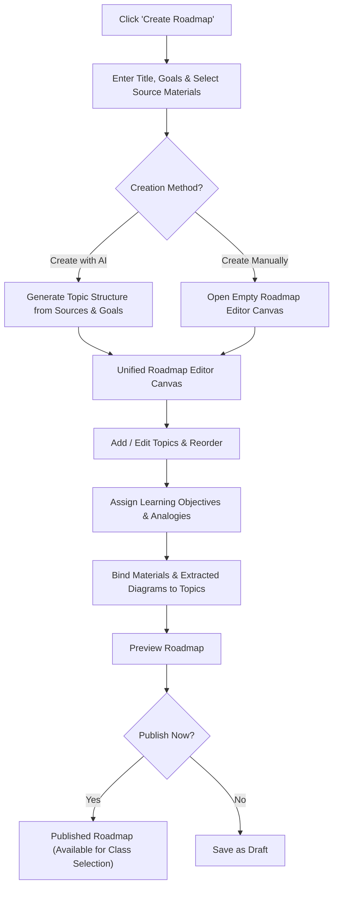

### Roadmap Editor Fields

| Field | Purpose |
| :--- | :--- |
| **Topic Title** | What the lecturer or AI will cover |
| **Learning Objectives** | Concrete concepts students must understand |
| **Description** | Topic-specific teaching guidance and pedagogical approach |
| **Source References** | Specific course materials and page ranges for this topic |
| **Suggested Duration** | Estimated minutes for planning and pacing |
| **Order** | Sequential index in the roadmap |

- **Topic Actions:** Add, edit, duplicate, drag-reorder, delete.
- **Roadmap Actions:** Save draft, preview, publish, archive, duplicate.

### Source Referencing Safeguards
- A roadmap can reference multiple Materials.
- Each topic can reference a subset of those Materials.
- Deleting a Material must not erase historical class references; display a `[Source Missing]` warning while preserving metadata.

---

## 11. Materials Tab

Materials represent the course's reusable source library.

```
Materials Library                                        [ 📤 Add Materials ]
[ 🔍 Search materials...                                             ]
Filters: [ All ]  [ Documents ]  [ PDFs ]  [ Links ]  [ Extracted Diagrams ]

• Java Fundamentals.pdf ──────── PDF · 2.4 MB · Indexed (18 Chunks)
• OOP Lecture Notes.docx ────── DOCX · 820 KB · Indexed (9 Chunks)
• Oracle Java Documentation ──── Link · External Source · Synced
• Fig 2.4 Heap Memory.png ────── Extracted Image · Bound to OOP Topic
```

### Add Materials & Details
- **Add Dialog:** Supports drag-and-drop, multi-file upload, URL indexing, and raw text paste with progress indicators and automatic retry.
- **Details Drawer:** Live preview, indexing/processing status, roadmap reference list, class history usage, rename, replace file, and delete.
- **Separation Rule:** Class notes are never mixed with original materials automatically. Teachers can explicitly click **"Save Notes as Material"** to promote class notes into a reusable study guide.

---

## 12. Students Tab & Lifecycle

```
Students Roster                                         [ 👥 Invite Students ]
┌──────────────────────────┐ ┌──────────────────────────┐ ┌──────────────────────────┐
│ 24 Enrolled              │ │ 3 Pending Requests       │ │ 2 Invited                │
└──────────────────────────┘ └──────────────────────────┘ └──────────────────────────┘
Tabs: [ Enrolled ]   [ Requests (3) ]   [ Invitations (2) ]

Pending Requests:
• [AR] Arjun Rao ── Requested 2 hours ago ── [ Approve ]  [ Reject ]
• [SK] Sara Khan ── Requested yesterday ──── [ Approve ]  [ Reject ]
```

### Student Lifecycle State Machine

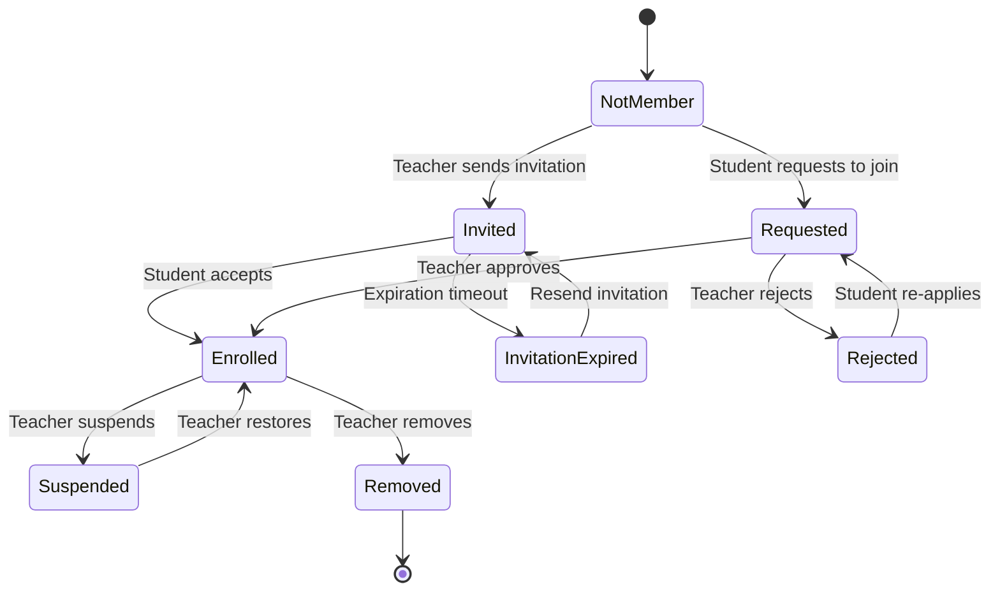

### Student Management Rules
- Invitations and join requests are scoped to the Course Space.
- Enrolled students gain eligibility to enter live classes scheduled in this space.
- Removing a student preserves past attendance, question logs, and quiz results in class history.

---

## 13. Classes Tab & Filtering

Classes are individual teaching sessions and their permanent records—not reusable templates.

```
Classes                                                 [ ➕ Create Class ]
Filters: [ All ]  [ Drafts ]  [ Scheduled ]  [ Active ]  [ History ]

• Java — Control Flow ────── [ 🟢 In Progress ] Today · 10:00 AM · 18 Students · [ Open Class ]
• Java — OOP Introduction ── [ 📅 Scheduled ]   Tomorrow · 11:00 AM · 24 Students · [ Edit ]
• Java — Variables ───────── [ ✓ Completed ]   Yesterday · 45 mins · 21 Students · [ View History ] [ Repeat ]
```

---

## 14. Create Class Workflow & The Three Choices

A single configuration modal handles all three execution paths:

```
┌────────────────────────────────────────────────────────────────────────┐
│ Create Class                                                         ✕ │
├────────────────────────────────────────────────────────────────────────┤
│ Class Title: [ Introduction to Object-Oriented Programming           ] │
│                                                                        │
│ Roadmap:     [ Java Programming — Fundamentals ▾ ] [ ➕ New Roadmap ]  │
│                                                                        │
│ Topics:      [✓] Intro to OOP   [✓] Classes & Objects   [ ] Inheritance│
│                                                                        │
│ Materials:   [✓] OOP Notes.pdf  [✓] Java Spec.pdf  (2 selected)        │
│                                                                        │
│ Students:    [ All enrolled students (24) ▾ ]                          │
│                                                                        │
│ Teaching:    45 mins · Prof. Arthur (Male) · Conversational · LiveKit  │
├────────────────────────────────────────────────────────────────────────┤
│ Choose how to handle this class:                                       │
│ [ 💾 Save Draft ]          [ 📅 Start Later ]           [ ▶️ Start Now ]│
└────────────────────────────────────────────────────────────────────────┘
```

### The Three Execution Flows

#### 1. Start Now Flow
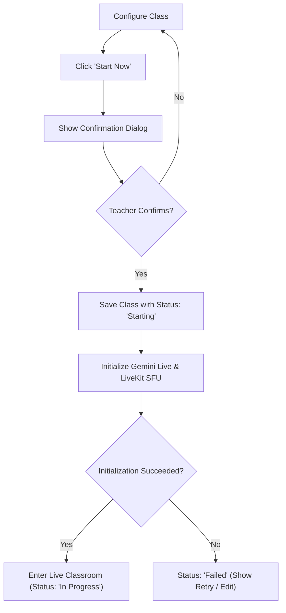

#### 2. Start Later Flow
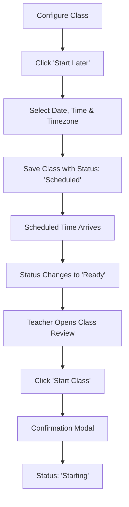

> [!KEY DECISION]
> Reaching the scheduled time **never** starts the live session automatically. It enters `Ready`, and the teacher explicitly confirms the launch.

#### 3. Save Draft Flow
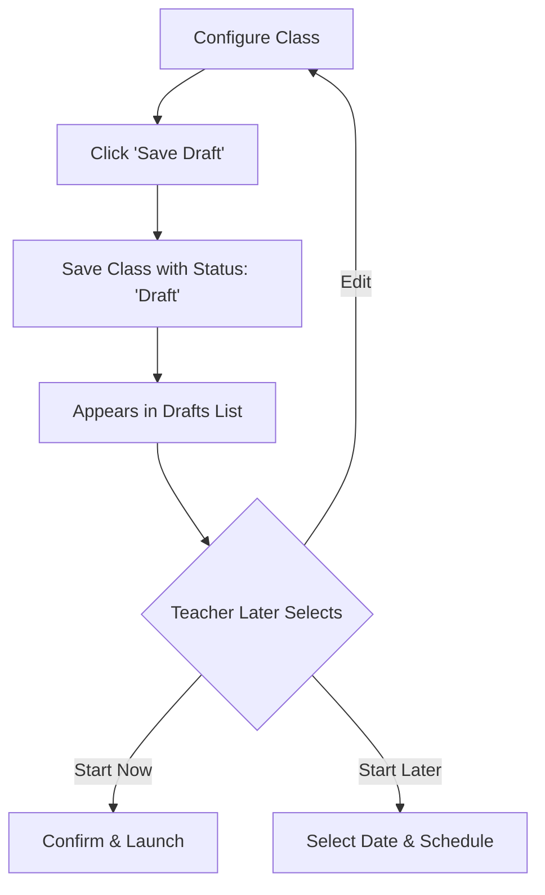

---

## 15. Class Detail and Configuration

Clicking a class card opens its dedicated detail page before launch.

- **Pre-Launch Sections:** Class overview, roadmap topics, source materials, students, schedule, teaching configuration.
- **Actions:** Edit configuration, change schedule, manage students, start class, cancel class, delete draft.

### Editing State Rules

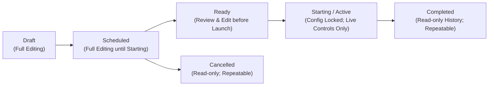

---

## 16. Live Classroom Screen & Studio Wireframe

The live class is a dedicated, full-screen studio—not another form.

```
┌────────────────────────────────────────────────────────────────────────────────────────┐
│  🟢 IN PROGRESS (00:18:32)  │  Introduction to OOP  │  Gemini Teaching  │  LiveKit: OK │
├──────────────────────────────────────────────────────┬─────────────────────────────────┤
│                                                      │ 📋 CURRENT PROGRESS             │
│                  3D AVATAR STAGE                     │ Topic 2 of 5: Classes & Objects │
│                                                      │ [✓] 1. Intro to OOP (Completed) │
│                 ┌──────────────────┐                 │ [▶] 2. Classes & Instances      │
│                 │   Prof. Arthur   │                 │ [ ] 3. Constructors             │
│                 │  (3D Humanoid)   │                 ├─────────────────────────────────┤
│                 │ Lip-sync: Active │                 │ 🖼️ WHITEBOARD PROJECTION        │
│                 └──────────────────┘                 │ ┌─────────────────────────────┐ │
│                                                      │ │ [Fig 2.4: Object Memory]    │ │
│  💬 CURRENT EXPLANATION                              │ │ Heap vs Stack Diagram       │ │
│  "A class is a blueprint that defines properties and │ └─────────────────────────────┘ │
│   behavior. An object is an instance created from it"├─────────────────────────────────┤
│  Based on: OOP Lecture Notes.pdf · Page 4            │ 📝 CLASS NOTES (AUTO-SAVED)     │
│                                                      │ • Defined class blueprint & obj │
│                                                      │ • Explained attributes & methods│
│                                                      │ [ Open Full Notes Drawer ]      │
├──────────────────────────────────────────────────────┴─────────────────────────────────┤
│  🎛️ CONTROLS: [ ⏸️ Pause ]  [ ✋ Floor Control (1) ]  [ ⏭️ Next Topic ]  [ ⏹️ End Class ] │
└────────────────────────────────────────────────────────────────────────────────────────┘
```

### Live Screen Regions & Actions

| Region | Content & Controls |
| :--- | :--- |
| **Header** | Class title, connection health, elapsed duration timer, live student count |
| **Teaching Panel** | 3D avatar with RMS lip-sync, current explanation text, audio visualizer |
| **Topic Panel** | Current roadmap topic, completed topics, upcoming learning objectives |
| **Projection Whiteboard** | Real-time diagram display triggered dynamically via `project_media` |
| **Notes Panel** | Continuously captured and auto-saved structured teaching notes |
| **Students Panel** | Live attendance, hand-raise queue, student question moderation |
| **Controls** | Pause, resume, next topic, repeat explanation, connection recovery, end class |

---

## 17. Notes Auto-Saving, Durable Checkpoints & Exact Resumption

Class notes are treated as an authoritative pedagogical journal—never disposable chat memory.

### Required Lifecycle Behavior

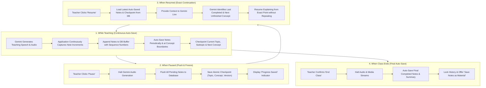

### Suggested Checkpoint Schema

```json
{
  "classId": "class_123",
  "roadmapId": "roadmap_456",
  "currentTopicId": "topic_02",
  "currentSubtopic": "Object creation",
  "lastCompletedConcept": "Class definition and attributes",
  "nextConcept": "Object instantiation",
  "completedConcepts": [
    "Class definition",
    "Attributes",
    "Methods"
  ],
  "notesVersion": 18,
  "lastNoteSequence": 42,
  "checkpointAt": "2026-11-17T10:30:00Z"
}
```

---

## 18. Complete Class Lifecycle State Machine

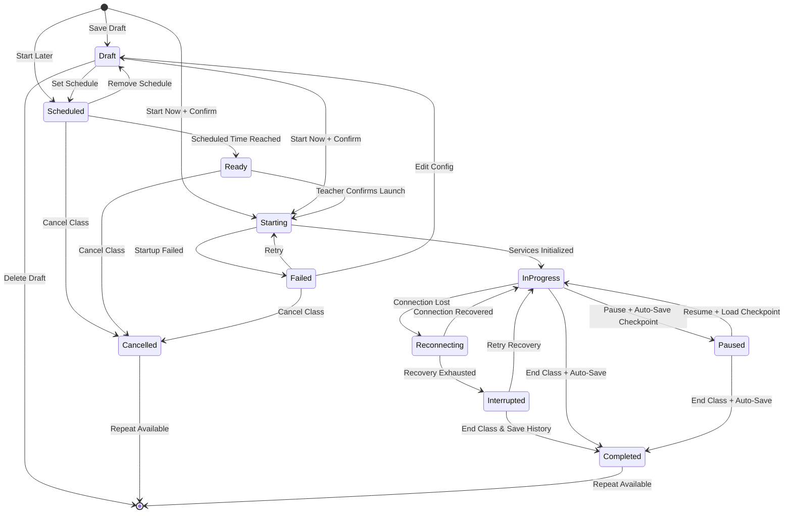

---

## 19. Repeating a Previous Class

Teachers can repeat any completed or cancelled class using its exact configuration.

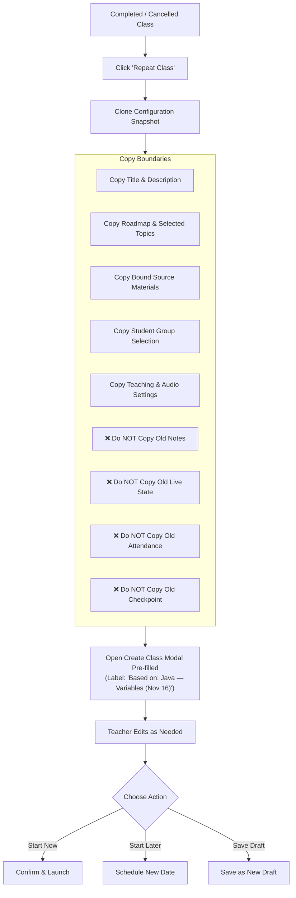

---

## 20. End Class Teardown, Auto-Save & History

### End Class Confirmation Modal
- **Displays:** Class duration, topics covered, student attendance count, questions answered, and notes auto-save status.
- **Actions:** `End and Save` or `Continue Teaching`.

### Automated Teardown & Auto-Save
1. Stop Gemini generation and dismantle audio streams.
2. Flush all pending class notes and auto-save final checkpoint.
3. Automatically generate an AI lecture summary and key concept recap.
4. Record student attendance departure timestamps.
5. Set class status to `Completed`.
6. Make notes immediately viewable and offer one-click **"Save Notes as Course Material"**.

### Class History Sections
- **Overview:** Class stats, duration, lecturer, and roadmap covered.
- **Teaching Notes:** Complete auto-saved notes formatted by topic.
- **Transcript:** Interaction log of lecture speech and Q&A.
- **Topics Covered:** Roadmap checklist marked with timestamps.
- **Source References:** Materials and page numbers cited.
- **Attendance & Participation:** Student join/leave logs and questions asked.
- **AI Summary:** Auto-generated executive recap.

---

## 21. Student Attention & Engagement Monitoring

During live lectures, client-side attention vision analysis posts alerts into `public.engagement_alerts`:

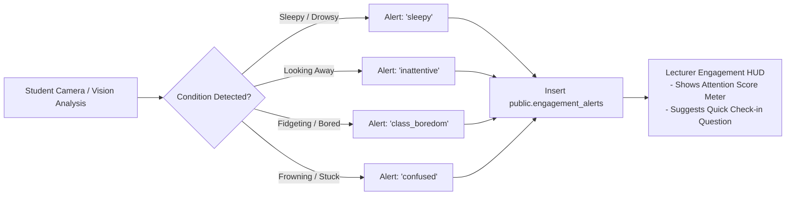

---

## 22. End-to-End User Flows

### A. Course Creation & Setup
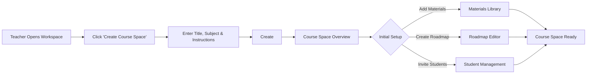

### B. Roadmap Creation
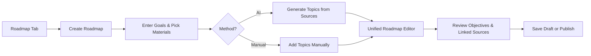

### C. Class Creation & Scheduling
```mermaid
flowchart LR
    ClassesTab["Classes Tab"] --> NewClass["Create Class"]
    NewClass --> PickRM["Select Roadmap & Topics"]
    PickRM --> PickSources["Select Sources & Students"]
    PickSources --> ConfigTeach["Set Duration & Voice"]
    ConfigTeach --> Decision{"Action?"}
    Decision -->|"Start Now"| Confirm["Confirmation Modal"] --> Starting["Starting Live"]
    Decision -->|"Start Later"| DatePick["Set Date/Time"] --> Sched["Scheduled"]
    Decision -->|"Save Draft"| DraftSave["Saved to Drafts"]
```

### D. Live Teaching & Auto-Save
```mermaid
flowchart LR
    Starting["Starting"] --> Init["Initialize Audio & Avatar"]
    Init --> InProg["In Progress: Stream Speech"]
    InProg --> AutoSave["Auto-Save Notes Continuously"]
    AutoSave --> Checkpoint["Update Progress Checkpoint"]
    Checkpoint --> Event{"Event?"}
    Event -->|"Pause"| Paused["Paused: Flush & Checkpoint"]
    Paused --> Resume["Resume: Inspect & Continue"] --> InProg
    Event -->|"Disconnect"| Reconnect["Reconnecting (<30s)"]
    Reconnect --> InProg
    Event -->|"End Class"| Complete["Complete: Auto-Save All & Final Summary"]
```

### E. Student Access & Management
```mermaid
flowchart LR
    StudentsTab["Students Tab"] --> ChooseAction{"Action?"}
    ChooseAction -->|"Invite"| SendInv["Enter Email & Send Invitation"] --> Await["Student Accepts"] --> Enrolled["Enrolled Roster"]
    ChooseAction -->|"Join Request"| PendingReq["Student Requests to Join"] --> ReviewReq{"Teacher Decision"}
    ReviewReq -->|"Approve"| Enrolled
    ReviewReq -->|"Reject"| Rejected["Request Rejected"]
    Enrolled --> ClassroomEligible["Eligible to Join Live Classes"]
```

---

## 23. Screen and Dialog Implementation Inventory

| Screen / Dialog | Primary Actions |
| :--- | :--- |
| **Workspace Home** | Search course spaces (`Ctrl + K`), create Course Space, open existing space |
| **Create Course Space** | Enter name, description, teaching instructions, submit |
| **Course Space Overview** | Launch quick-actions: Start Class, Create Roadmap, Add Materials, Invite Students |
| **Course Space Settings** | Edit course metadata, update teaching guidelines, archive, delete |
| **Roadmap Management** | View active/draft roadmaps, create, edit, duplicate, archive, publish |
| **Create Roadmap Dialog** | Configure title, goals, target level, select sources, choose AI vs manual |
| **Roadmap Editor Canvas** | Add, edit, drag-reorder topics, assign objectives, link source files |
| **Materials Library** | Upload files, drag-drop, filter by type, preview, search |
| **Material Details Drawer** | Inspect indexing status, view chunk references, rename, replace, remove |
| **Students Roster** | View enrolled list, search students, remove or suspend membership |
| **Invite Students Dialog** | Enter emails, send invitations, copy course invitation link |
| **Join Requests Drawer** | Review pending requests, approve, reject |
| **Classes Screen** | Filter by status (Drafts, Scheduled, Active, History), search, create class |
| **Create Class Dialog** | Configure title, roadmap, topic checkboxes, sources, students, voice persona |
| **Schedule Sub-Dialog** | Pick date, time, timezone |
| **Start Confirmation Dialog** | Review class configuration snapshot, confirm and start |
| **Class Detail Page** | Pre-launch review, edit settings, reschedule, cancel, launch |
| **Live Classroom Studio** | Full-screen stage: 3D avatar, notes panel, floor control, next topic, pause, end |
| **Notes Drawer** | View live auto-saved notes, search notes, manually annotate |
| **Connection Recovery Screen** | Automatic reconnection status, manual retry, end session |
| **End Class Dialog** | Review duration, covered topics, student count, confirm final auto-save |
| **Class History Page** | Review auto-saved notes, full transcript, attendance, summary, repeat class |

---

## 24. Pragmatic Entity-Relationship Data Model

This model reflects the active database schema in Supabase PostgreSQL, retaining only functional, useful tables while removing dead-end sync tables.

```mermaid
erDiagram
    COURSES ||--o{ COURSE_FILES : "contains"
    COURSES ||--o{ DOCUMENT_CHUNKS : "chunks_into"
    COURSES ||--o{ MEDIA_ASSETS : "indexes"
    COURSES ||--o{ SESSIONS : "hosts"

    SESSIONS ||--o{ SESSION_PARTICIPANTS : "enrolls"
    SESSIONS ||--o{ MESSAGES : "records"
    SESSIONS ||--o{ ENGAGEMENT_ALERTS : "captures"
    SESSIONS ||--o{ MEDIA_ASSETS : "projects"

    COURSES {
        uuid id PK
        text title
        text description
        text cover_image
        uuid created_by
        timestamptz created_at
    }

    COURSE_FILES {
        uuid id PK
        uuid course_id FK
        text file_name
        text file_path
        text file_type
        bigint file_size
        uuid uploaded_by
        timestamptz created_at
    }

    DOCUMENT_CHUNKS {
        uuid id PK
        uuid course_id FK
        text content
        vector embedding "768 Dimensions (gemini-embedding-001)"
        jsonb metadata "page, source"
        timestamptz created_at
    }

    MEDIA_ASSETS {
        uuid id PK
        uuid course_id FK
        uuid session_id FK
        text type "image | video"
        text file_url
        text label
        text source "pdf_extracted | lecturer_upload"
        timestamptz created_at
    }

    SESSIONS {
        uuid id PK
        uuid course_id FK
        text topic
        text script
        text status "created | running | paused | ended | deleted"
        text voice_id
        text avatar_model
        text meeting_code
        text active_driver_tab_id "Conductor Lease Lock"
        timestamptz driver_lease_expires_at
        int state_version
        jsonb roadmap "SessionRoadmap JSON"
        text current_topic_id
        jsonb covered_topic_ids
        jsonb live_session_stats "Durable Checkpoint & Notes JSON"
        timestamptz created_at
    }

    SESSION_PARTICIPANTS {
        uuid id PK
        uuid session_id FK
        uuid user_id FK
        text user_name
        text role "lecturer | student"
        text status "waiting | admitted | denied | left"
        timestamptz joined_at
        timestamptz admitted_at
    }

    MESSAGES {
        uuid id PK
        uuid session_id FK
        uuid user_id
        text role "user | ai | system"
        text message
        timestamptz created_at
    }

    ENGAGEMENT_ALERTS {
        uuid id PK
        uuid session_id FK
        uuid user_id
        text alert_type "sleepy | inattentive | class_boredom | confused"
        text intervention_text
        boolean resolved
        timestamptz created_at
    }
```

> [!CRITICAL DATA RULE]
> Save an immutable configuration snapshot and roadmap snapshot inside `public.sessions.roadmap`. If a teacher later edits or reorders topics in the course roadmap, it must never rewrite or invalidate previously conducted class history or auto-saved notes.

---

## 25. Operational Guardrails & Edge Cases

| Situation | UX Guardrail & System Behavior |
| :--- | :--- |
| **No roadmap exists** | Show inline `Create Roadmap` button inside Create Class without losing inputs. |
| **No materials exist** | Show `Add Materials` directly in source selector; allow general lecture without files. |
| **Roadmap source deleted** | Display `[Source Missing]` warning; preserve past class notes and citations. |
| **Scheduled time arrives** | Transition class to `Ready` and notify teacher; never auto-broadcast without teacher. |
| **Teacher edits scheduled class** | Preserve meeting code and student links; update time and show revised badge. |
| **Student is removed** | Remove from active course roster; preserve historical attendance and question logs. |
| **Gemini socket disconnects** | Automatically save notes and checkpoint; show `Reconnecting` overlay with recovery options. |
| **Notes saving delayed** | Show visible `Saving...` indicator; queue in memory and retry until acknowledged. |
| **Teacher resumes class** | Inspect durable checkpoint and auto-saved notes before speaking to prevent duplicate explanation. |
| **Class completes** | Lock session configuration snapshot, auto-save summary, and make history read-only. |
| **Teacher repeats class** | Create a brand-new class instance from configuration snapshot with fresh notes and attendance. |
| **Student mic floor abuse** | Lecturer can click "Mute Student" at any time; backend immediately revokes LiveKit `Microphone` publishing rights. |
| **Multiple tabs opened** | Conductor lease lock (`active_driver_tab_id`) prevents duplicate WebSocket connections to Gemini Live. |

---

## 26. Final Navigation & Primary Journeys

```mermaid
flowchart TD
    AppHome["IntelliClass AI Home"] --> NavChoice{"Navigation"}
    NavChoice --> CSNav["Course Spaces"]
    NavChoice --> ClassesNav["All Classes"]
    NavChoice --> RequestsNav["Student Requests"]

    CSNav --> OpenCS["Open Course Space (e.g. Java Programming)"]
    OpenCS --> CSOverview["Overview & Stats"]
    OpenCS --> CSRoadmap["Roadmap Management"]
    OpenCS --> CSMaterials["Materials Library"]
    OpenCS --> CSStudents["Student Roster"]
    OpenCS --> CSClasses["Classes List"]

    CSOverview --> QuickActions{"Quick Actions"}
    QuickActions -->|"New Roadmap"| CSRoadmap
    QuickActions -->|"Upload"| CSMaterials
    QuickActions -->|"Invite"| CSStudents
    QuickActions -->|"Start Class"| CreateClassModal["Create Class Modal"]

    CSClasses --> CreateClassModal
    CreateClassModal --> ExecChoice{"Choose Path"}

    ExecChoice -->|"Start Now"| Launch["Confirm & Launch"]
    Launch --> LiveStudio["Live Classroom Studio"]
    LiveStudio --> AutoNotes["Continuous Notes Auto-Save"]
    AutoNotes --> PauseResume["Pause / Resume with Checkpoints"]
    PauseResume --> EndClass["End Class & Auto-Save History"]
    EndClass --> HistoryRecord["Class History Record"]
    HistoryRecord --> RepeatClass["Repeat Class (Clones Config)"]

    ExecChoice -->|"Start Later"| Schedule["Scheduled → Ready → Launch"]
    Schedule --> LiveStudio

    ExecChoice -->|"Save Draft"| DraftSave["Draft Saved for Later"]
```

### Core Product Decisions to Lock

1. **One Course Space can hold multiple roadmaps**, but each class explicitly binds to one roadmap snapshot.
2. **Roadmap creation paths converge:** AI-assisted and manual authoring output the exact same editable schema.
3. **A class is an independent execution instance**, not a reusable template.
4. **Scheduled classes require explicit teacher launch** upon becoming Ready.
5. **Class configurations lock at launch**, protecting historical records from future course-level edits.
6. **Class notes are auto-saved continuously and on completion**, ensuring zero note loss.
7. **Repeating a class clones configuration only**, generating fresh notes, clean attendance, and a new session ID.
8. **Course membership and class attendance are decoupled:** Enrollment determines access rights; class attendance is logged per session.
