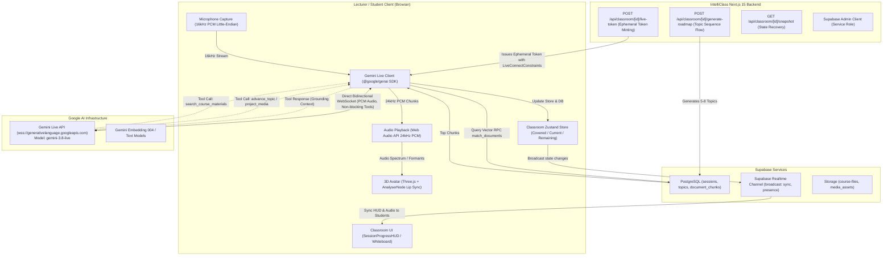
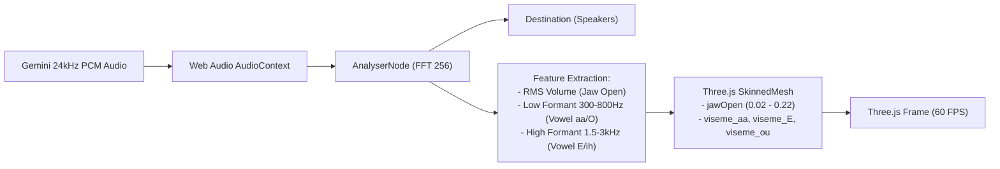
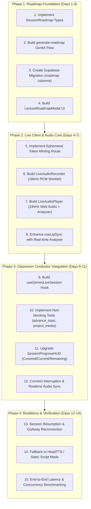

# IntelliClass AI: Gemini Live API Integration Plan
## Architectural Blueprint: Real-Time Dynamic AI Professor

---

## Executive Summary

This architecture document details the end-to-end plan to transform the **IntelliClass AI Monorepo** from a rigid, pre-generated script and chunked text-to-speech (TTS) playback system into an **autonomous, conversational, real-time AI Professor powered by the Google Gemini Live API**.

Rather than relying on lengthy, monolithic scripts that take 10+ seconds to generate and freeze teaching into static audio queues, the AI Professor operates over a **lightweight, adaptive topic roadmap**. The professor streams bidirectional audio directly to students, dynamically formulates pedagogical explanations, adapts examples on the fly, answers interruptions organically in real-time, projects visual media onto the classroom board, and maintains strict curriculum progress across network interruptions, multi-tab conductor handoffs, and classroom sessions.

---

## 1. Existing Architecture Analysis

The existing IntelliClass AI repository is an educational virtual classroom platform structured as a multi-tier monorepo:

```
IntelliClass-AI-MonoRepo/
├── model-next/            # Next.js 15 (App Router), React 19, Tailwind, Three.js avatar
│   ├── ai/                # Genkit flows, Gemini model-manager fallback
│   ├── app/               # Routes: /course/[id], /classroom/[id], /api/...
│   ├── features/
│   │   ├── classroom/     # Conductor loop, useClassroom, useSpeechQueue, sync
│   │   ├── avatar/        # Three.js 3D avatar, useLipSync, audioManager
│   │   ├── materials/     # Document & image viewer modals
│   │   └── settings/      # Audio, model, persona configuration
│   ├── lib/               # Supabase clients, TTS adapters, config
│   └── supabase-*.sql     # Database migrations
├── ai-backend/            # Python FastAPI service
│   ├── services/          # PyMuPDF extractor, text chunker, gemini embedder
│   └── main.py            # /process, /extract-images, /session
├── HeadTTS/               # Local ONNX Kokoro-82M TTS service (port 8882)
└── benchmark/             # Performance measurements and benchmark reports
```

### 1.1 Current Teaching Lifecycle & Execution Pipeline

1. **Course Material Upload & Ingestion**:
   - The instructor uploads course PDFs via `model-next/app/course/[courseId]/materials`.
   - `ai-backend/main.py` extracts text with PyMuPDF, chunks the text, computes vector embeddings (`googleai/gemini-embedding-001`), and stores them in Supabase's `document_chunks` table (`pgvector`).
   - Embedded diagrams and figures are extracted to Supabase Storage `course-files` and indexed in `media_assets`.

2. **Session Creation & Pre-Generated Script Generation**:
   - In `model-next/app/course/[courseId]/sessions/new/page.tsx`, the lecturer selects course documents and enters a lecture topic.
   - The endpoint `POST /api/classroom/[sessionId]/generate-script` calls `generateTeachingScriptFlow` (`model-next/ai/flows/generate-script.ts`).
   - Gemini (via Genkit and `executeWithModelFallback`) generates a **rigid, 1,200+ word monolithic script** containing embedded cues: `[ENGAGEMENT]`, `[IMAGE: url | label]`.
   - The entire raw script string is stored in `sessions.script` in Supabase.

3. **Client-Side Classroom Conductor & Audio Playback**:
   - In `model-next/features/classroom/hooks/useClassroom.ts`, the browser parses the monolithic script into discrete sequential items using `parseLectureScript`:
     - `LectureSpeechItem` (speech sentences/phrases split to ~75 characters).
     - `LectureImageItem` / `LectureVideoItem` (diagram projections).
     - `LectureEngagementItem` (comprehension checkpoints).
   - An elected lecturer browser tab holds an **Atomic Conductor Lease** (`driverTabId`, `driver_lease_expires_at`).
   - The conductor loops sequentially through items using `scheduleAdvance()`.
   - For every speech item, the conductor fetches synthesized audio from `/api/tts` (orchestrated by `model-next/lib/tts/ttsProviders.ts` via HeadTTS or ElevenLabs).
   - HeadTTS generates uncompressed WAV audio + an array of pre-computed viseme timestamps (`HeadTTSData`: `visemes`, `vtimes`, `vdurations`).
   - The conductor broadcasts a `PLAY_ITEM` event over Supabase Realtime with a future hardware-synchronized start timestamp (`targetEpochMs` calculated via SNTP in `clockSync.ts`).
   - All admitted student tabs receive `PLAY_ITEM`, preload the audio buffer, and trigger playback at the exact target millisecond.

4. **Student Q&A Interruption Handling**:
   - A student submits a question via voice/text in the classroom chat.
   - The conductor pauses the speech queue and cancels active audio.
   - The conductor calls `POST /api/classroom/[sessionId]/question` -> `studentAIQuestionAnsweringFlow` (`model-next/ai/flows/answer-question.ts`).
   - A 350ms race query performs vector search against `document_chunks`.
   - A static REST call generates a text answer (`maxOutputTokens: 600`).
   - The text is passed to HeadTTS/ElevenLabs to generate an audio file.
   - The conductor broadcasts an `INTERRUPT` event, plays the Q&A audio, and resumes the lecture from the interrupted item (`resumeFromItemId`).

---

## 2. Current Limitations and Architectural Gaps

Based on actual codebase analysis and benchmark results (`benchmark/BENCHMARK_REPORT.md`), the current design exhibits critical architectural bottlenecks:

| Architecture Component | Current Implementation | Critical Bottleneck / Architectural Gap |
| :--- | :--- | :--- |
| **Curriculum Generation** | Monolithic text script (1,200+ words) pre-generated via REST. | High generation latency (**3.1s to 10.3s** in benchmarks). Frequently encounters `503 UNAVAILABLE` under peak demand. Fails completely if the API times out. |
| **Teaching Flexibility** | Linear, immutable playback of pre-baked sentences. | **Zero pedagogical dynamism.** The professor cannot elaborate, simplify, change pacing, or use alternative analogies if students struggle. |
| **Interruption Latency** | Pipeline: Text STT -> Vector RAG -> REST text generation -> TTS synthesis -> Buffer download -> Scheduled playback. | **Severe conversational lag (5 to 12 seconds).** Benchmark reveals HeadTTS alone takes **~2.95s** to synthesize 25 words. Destroys natural conversational rhythm. |
| **Audio Pipeline** | Server-side disk caching of WAV files in `/api/media/audio`. | Heavy local I/O overhead, potential disk-write race conditions, uncompressed WAV storage footprint. |
| **Avatar Lip Sync** | Hard dependency on pre-computed viseme timestamp arrays (`HeadTTSData`). | Blocks live streaming audio models which output raw PCM chunks rather than pre-aligned viseme timing metadata. |
| **Bandwidth & Compute** | Each client downloads static WAV files (384 kbps) generated by local Kokoro-82M ONNX server. | Requires dedicated CPU/GPU resources on the host machine to run HeadTTS (`localhost:8882`). |
| **Context Retention** | Q&A flow answers doubts in isolation and blindly jumps back to `resumeFromItemId`. | The professor does not smoothly incorporate student questions into subsequent explanations or check whether the student understood the answer. |

---

## 3. Recommended Target Architecture

### 3.1 Target Paradigm: Real-Time Dynamic AI Professor

The target architecture replaces the pre-generated script and multi-step TTS pipeline with a **Gemini 3.8 Live API WebSocket pipeline**. 

- The professor receives a **lightweight topic roadmap** (5–8 structured learning checkpoints).
- The professor **speaks dynamically and naturally** using native voice-to-voice bidirectional streaming.
- Students can interrupt verbally with near-zero latency (~300–450ms).
- Gemini tracks session progress via **asynchronous tool calling (function calling)**, reporting topic transitions and whiteboard projections back to the client.
- The browser drives the 3D avatar's mouth in real-time using **Web Audio frequency domain analysis (AnalyserNode)** directly from the incoming audio stream.

### 3.2 Target Architecture Diagram



---

## 4. Lightweight Topic-Roadmap Generation & Data Structure

### 4.1 Concept

Instead of a monolithic spoken script, the system generates a **Topic Roadmap**: an ordered array of 4 to 8 pedagogical checkpoints. Each topic contains core objectives, key terms, suggested analogies, and relevant visual diagram references. Gemini decides how to speak, elaborate, and pace the content in real time.

### 4.2 TypeScript Schema (`features/classroom/types/roadmap.ts`)

```typescript
export interface VisualAssetRef {
  id: string;
  url: string;
  label: string;
  caption?: string;
}

export interface RoadmapSubtopic {
  id: string;
  title: string;
  keyConcepts: string[];
}

export interface RoadmapTopic {
  id: string;
  order: number;
  title: string;
  description: string;
  learningObjectives: string[];
  subtopics: RoadmapSubtopic[];
  suggestedAnalogies: string[];
  suggestedVisualAssets: VisualAssetRef[];
  estimatedDurationMinutes: number;
  status: "pending" | "in_progress" | "completed";
}

export interface SessionRoadmap {
  version: "2.0";
  courseId: string;
  sessionId: string;
  lectureTopic: string;
  totalEstimatedMinutes: number;
  persona: {
    name: string;
    teachingStyle: string;
  };
  topics: RoadmapTopic[];
}
```

### 4.3 Generation Flow (`model-next/ai/flows/generate-roadmap.ts`)

```typescript
import { ai } from "@/ai/genkit";
import { z } from "genkit";
import { googleAI } from "@genkit-ai/google-genai";
import { createAdminClient } from "@/lib/supabase/admin";
import { executeWithModelFallback } from "@/ai/model-manager";

export const GenerateRoadmapInputSchema = z.object({
  courseId: z.string(),
  topic: z.string(),
  sources: z.array(z.object({ fileName: z.string() })).optional(),
  customPrompt: z.string().optional(),
  targetDurationMinutes: z.number().default(20),
});

export const GenerateRoadmapOutputSchema = z.object({
  status: z.literal("success"),
  roadmap: z.custom<SessionRoadmap>(),
  chunksUsed: z.number(),
  modelUsed: z.string(),
});
```

**Prompt Engineering Directive**:
- Instruct Gemini to analyze course materials and output **only** high-level learning objectives, concept definitions, and intuitive analogies (e.g., real-world metaphors).
- **Hard Constraint**: Prohibit word-for-word spoken paragraphs. Output structured JSON matching `SessionRoadmap`.
- Generation latency: Drops from **~8,000ms** (for full scripts) to **~1,200ms**, with token consumption reduced by **85%**.

---

## 5. Complete Teaching Lifecycle

```mermaid
sequenceDiagram
    autonumber
    actor Lecturer as Lecturer (Host/Conductor)
    actor Student as Students
    participant App as IntelliClass Client
    participant API as Next.js API Routes
    participant DB as Supabase DB & Realtime
    participant Live as Gemini Live API (WebSocket)

    %% Phase 1: Setup
    Note over Lecturer, API: 1. Setup & Roadmap Generation
    Lecturer->>App: Create session with Topic & Course Materials
    App->>API: POST /api/classroom/[id]/generate-roadmap
    API->>DB: Query document_chunks & media_assets
    API->>API: Generate SessionRoadmap (5-8 topics)
    API->>DB: Save roadmap to sessions.roadmap
    API-->>App: Return SessionRoadmap
    App->>Lecturer: Display Roadmap Preview Modal (Approve / Reorder)

    %% Phase 2: Live Connection
    Note over Lecturer, Live: 2. Ephemeral Authentication & Live Session
    Lecturer->>App: Click "Start Live Class"
    App->>API: POST /api/classroom/[id]/live-token
    API->>API: Mint Gemini Ephemeral Token with LiveConnectConstraints
    API-->>App: Return token + Roadmap + System Instructions
    App->>Live: Connect WebSocket (gemini-3.8-live, Ephemeral Token)
    Live-->>App: Connection Established (Session Resumption Handle saved)
    App->>DB: Update sessions.status = 'running', active_driver_tab_id

    %% Phase 3: Teaching & Tools
    Note over App, Live: 3. Dynamic Teaching & Progress Tracking
    App->>Live: sendRealtimeInput({ text: "Class has begun. Welcome students and introduce Topic 1." })
    Live-->>App: 24kHz PCM Audio Stream + Output Transcription
    App->>App: Web Audio plays sound; AnalyserNode moves avatar lips
    App->>DB: Supabase Realtime broadcast: AUDIO_STREAM & SUBTITLE
    DB-->>Student: Synchronized Audio & Subtitles
    
    Live->>App: Tool Call: advance_topic({ topicId: "top_1", status: "in_progress" })
    App->>DB: Update sessions.current_topic_id = 'top_1'
    App->>DB: Realtime Broadcast TOPIC_CHANGED
    DB-->>Student: Update SessionProgressHUD (Covered: 0, Current: Topic 1)

    %% Phase 4: Interruption
    Note over Student, Live: 4. Student Live Interruption
    Student->>App: Speak / Type Question: "Professor, how does this relate to X?"
    App->>DB: Realtime Broadcast STUDENT_INTERRUPT
    App->>Live: sendRealtimeInput({ audio: studentAudioPCM, audioStreamEnd: true })
    Live-->>App: Spoken filler ("Great question, let us clarify that...")
    Live->>App: Tool Call: search_course_materials({ query: "X relation" })
    App->>DB: Vector RPC match_documents
    DB-->>App: Context chunks
    App->>Live: sendToolResponse({ result: chunks })
    Live-->>App: Spoken Answer + Natural Pivot: "Now, let us continue our topic."
    
    %% Phase 5: Completion
    Live->>App: Tool Call: complete_lecture({ summary: "All topics covered." })
    App->>DB: Update sessions.status = 'ended'
    App->>Lecturer: Display Lecture Summary & Student Analytics
```

---

## 6. Covered / Current / Remaining Topic Progress Management

### 6.1 State Segmentation Contract

The classroom maintains an authoritative tripartite state:

```typescript
export interface RoadmapProgressState {
  coveredTopics: RoadmapTopic[];     // status === 'completed'
  currentTopic: RoadmapTopic | null; // status === 'in_progress'
  remainingTopics: RoadmapTopic[];   // status === 'pending'
  progressPercentage: number;
}
```

### 6.2 Topic Transition via Asynchronous Tool Calling (Function Calling)

Gemini controls topic advancement autonomously via non-blocking function calls.

#### Tool Declarations (`lib/gemini-live/tools.ts`)

```typescript
export const classroomTools = [
  {
    name: "advance_topic",
    description: "Call this when completing the current topic and transitioning to the next topic in the roadmap, or when resuming a previous topic.",
    behavior: "NON_BLOCKING", // Required for Gemini 3.8 Live
    parameters: {
      type: "OBJECT",
      properties: {
        completedTopicId: {
          type: "STRING",
          description: "ID of the topic that was just completed.",
        },
        nextTopicId: {
          type: "STRING",
          description: "ID of the next topic being introduced.",
        },
        transitionReason: {
          type: "STRING",
          description: "Brief rationale (e.g. 'Student doubts resolved; concept mastered').",
        },
      },
      required: ["nextTopicId"],
    },
  },
  {
    name: "project_media",
    description: "Display a visual diagram, circuit, slide, or figure on the classroom projection screen.",
    behavior: "NON_BLOCKING",
    parameters: {
      type: "OBJECT",
      properties: {
        assetId: {
          type: "STRING",
          description: "ID of the media asset from the roadmap.",
        },
        caption: {
          type: "STRING",
          description: "Spoken caption or context for the projection.",
        },
      },
      required: ["assetId"],
    },
  },
  {
    name: "search_course_materials",
    description: "Retrieve specific textbook facts, definitions, or equations from course materials when a student asks a detailed question.",
    behavior: "NON_BLOCKING",
    parameters: {
      type: "OBJECT",
      properties: {
        query: {
          type: "STRING",
          description: "Search query for course vector embeddings.",
        },
      },
      required: ["query"],
    },
  },
];
```

### 6.3 Conductor Handling of Tool Calls

When `onmessage` receives a `toolCall`:
1. The client matches `advance_topic`.
2. Updates local Zustand state: moves `completedTopicId` to `coveredTopics`, sets `nextTopicId` as `currentTopic`.
3. Calls Supabase `PATCH /api/classroom/[sessionId]` to persist `current_topic_id` and `topics_progress` JSON.
4. Broadcasts `TOPIC_CHANGED` via Supabase Realtime so all connected students' HUDs animate simultaneously.
5. Returns `session.sendToolResponse({ response: { output: { acknowledged: true } } })` to Gemini Live.

---

## 7. Adaptive Teaching & Student-Interaction Workflow

### 7.1 Zero-Call Adaptive Mechanism

In the legacy design, adapting teaching required an explicit HTTP round-trip and a new prompt call. In the Gemini Live API, **adaptation occurs organically within the single live conversation stream**:

1. **Pacing & Comprehension Checks**:
   - The system instructions direct Gemini to inject rhetorical or conversational checkpoints: *"Does that distinction make sense to everyone?"*
2. **Student Interruptions**:
   - When a student speaks, server-side Voice Activity Detection (VAD) immediately fires an `interrupted: true` event.
   - The browser immediately silences audio output and flushes buffered audio frames.
   - Gemini naturally pauses its lecture and replies: *"Yes, Aryan, what is your doubt regarding cache coherence?"*
3. **Revisiting Previous Topics**:
   - If a student asks about a concept from a topic already marked as `covered`, Gemini answers using the topic context already present in its 128k token context window.
   - If an extensive review is warranted, Gemini calls `advance_topic({ nextTopicId: "topic_1", transitionReason: "Student requested review of fundamental concepts" })`.
   - The HUD updates smoothly without resetting session state.
4. **Seamless Continuation**:
   - Once the doubt is resolved, Gemini resumes from the exact pedagogical subtopic without repeating already explained concepts: *"With that cleared up, let us return to our discussion on pipelined hazard detection..."*

---

## 8. Gemini Live Audio Streaming & Interruption Handling

### 8.1 Audio Protocol Specifications

| Direction | Format | Sample Rate | Bit Depth | Channels | MIME Type |
| :--- | :--- | :--- | :--- | :--- | :--- |
| **Input (Mic)** | Raw PCM Little-Endian | 16,000 Hz | 16-bit | Mono | `audio/pcm;rate=16000` |
| **Output (Speaker)** | Raw PCM Little-Endian | 24,000 Hz | 16-bit | Mono | Standard Web Audio stream |

### 8.2 Client-Side Audio Pipeline (`lib/gemini-live/audio-streamer.ts`)

```typescript
// Input Audio: Capturing Student/Lecturer Mic
export class LiveAudioRecorder {
  private audioCtx: AudioContext | null = null;
  private processor: ScriptProcessorNode | AudioWorkletNode | null = null;
  private stream: MediaStream | null = null;

  async start(onAudioChunk: (base64PCM: string) => void) {
    this.stream = await navigator.mediaDevices.getUserMedia({
      audio: {
        channelCount: 1,
        sampleRate: 16000,
        echoCancellation: true,
        noiseSuppression: true,
      },
    });

    this.audioCtx = new AudioContext({ sampleRate: 16000 });
    const source = this.audioCtx.createMediaStreamSource(this.stream);

    // Downsample/convert Float32Array to 16-bit PCM Little-Endian
    const workletNode = new AudioWorkletNode(this.audioCtx, "pcm-recorder-worklet");
    workletNode.port.onmessage = (event) => {
      const pcm16 = event.data; // Int16Array
      const base64 = bufferToBase64(pcm16.buffer);
      onAudioChunk(base64);
    };

    source.connect(workletNode);
    workletNode.connect(this.audioCtx.destination);
  }

  stop() {
    this.stream?.getTracks().forEach((t) => t.stop());
    this.audioCtx?.close();
  }
}
```

### 8.3 Output Playback with Immediate Interruption Flush

```typescript
export class LiveAudioPlayer {
  private audioCtx: AudioContext;
  private scheduledTime: number = 0;
  private activeSources: AudioBufferSourceNode[] = [];
  public analyserNode: AnalyserNode;

  constructor() {
    this.audioCtx = new (window.AudioContext || (window as any).webkitAudioContext)({
      sampleRate: 24000,
    });
    this.analyserNode = this.audioCtx.createAnalyser();
    this.analyserNode.fftSize = 256;
    this.analyserNode.smoothingTimeConstant = 0.2;
    this.analyserNode.connect(this.audioCtx.destination);
  }

  playChunk(pcmData: Int16Array) {
    if (this.audioCtx.state === "suspended") {
      this.audioCtx.resume();
    }

    const float32 = new Float32Array(pcmData.length);
    for (let i = 0; i < pcmData.length; i++) {
      float32[i] = pcmData[i] / 32768.0;
    }

    const buffer = this.audioCtx.createBuffer(1, float32.length, 24000);
    buffer.getChannelData(0).set(float32);

    const source = this.audioCtx.createBufferSource();
    source.buffer = buffer;
    source.connect(this.analyserNode);

    const now = this.audioCtx.currentTime;
    const startTime = Math.max(now, this.scheduledTime);
    source.start(startTime);
    this.scheduledTime = startTime + buffer.duration;

    this.activeSources.push(source);
    source.onended = () => {
      this.activeSources = this.activeSources.filter((s) => s !== source);
    };
  }

  stopAndFlush() {
    for (const source of this.activeSources) {
      try {
        source.stop();
        source.disconnect();
      } catch {}
    }
    this.activeSources = [];
    this.scheduledTime = 0;
  }
}
```

---

## 9. RAG & Course-Material Integration During Live Sessions

Live conversations require grounding without halting the voice experience. The architecture uses a **two-tier hybrid grounding model**:

### Tier 1: In-Context Static Grounding (Zero Latency)
- When initializing the Live API session via `types.LiveConnectConfig`, the lightweight topic roadmap, core definitions, and visual asset inventory are passed inside `systemInstruction`.
- This ensures Gemini already knows the course terminology, syllabus boundaries, and available diagrams without making any external queries.

### Tier 2: Real-Time Vector RAG via Asynchronous Tool Call
- If a student asks a highly specific technical doubt (e.g., *"Does the textbook define equation 4.2 with relativistic mass or invariant mass?"*), Gemini triggers the non-blocking tool:
  `search_course_materials({ query: "equation 4.2 relativistic mass" })`
- **Non-blocking Behavior**: Because the tool declaration has `behavior: "NON_BLOCKING"`, Gemini speaks natural conversational fillers (*"Let me look up the exact formula from your textbook..."*) while the search runs in the background.
- The client queries Supabase vector RPC:
  ```sql
  SELECT content, metadata FROM match_documents(
    query_embedding := :embedding,
    match_threshold := 0.65,
    match_count := 3,
    course_id_filter := :courseId
  );
  ```
- The client returns the text chunks via `session.sendToolResponse()`.
- Gemini incorporates the exact definition into its spoken explanation.

---

## 10. Exact Existing Files to Modify, Retain, or Replace

| File Path | Action | Rationale / Architectural Impact |
| :--- | :--- | :--- |
| `model-next/ai/genkit.ts` | **Retain** | Retained for background batch tasks (PDF processing, roadmap generation). |
| `model-next/ai/model-manager.ts` | **Retain & Extend** | Retain fallback logic for text tasks; add discovery and health checking for `gemini-3.8-live` and `gemini-3.8-live-extended-thinking`. |
| `model-next/ai/flows/generate-script.ts` | **Replace / Deprecate** | Replace with `model-next/ai/flows/generate-roadmap.ts`. Monolithic script generation is obsolete in the live model. |
| `model-next/ai/flows/answer-question.ts` | **Modify / Keep as Fallback** | Retain for offline chat or text-only fallback; live audio doubts are handled natively in the Live WebSocket session. |
| `model-next/app/course/[courseId]/sessions/new/page.tsx` | **Modify** | Update session creation to generate the Topic Roadmap instead of the 1,200-word script. Replace the full script editor with a draggable topic roadmap modal. |
| `model-next/app/api/classroom/[sessionId]/generate-script/route.ts` | **Replace** | Replace with `/api/classroom/[sessionId]/generate-roadmap/route.ts`. |
| `model-next/app/api/classroom/[sessionId]/route.ts` | **Modify** | Add `roadmap`, `current_topic_id`, and `topics_progress` to the allowed update fields whitelist. Keep conductor lease arbitration. |
| `model-next/features/classroom/hooks/useClassroom.ts` | **Refactor** | Decouple from sequential `parseLectureScript` items and HeadTTS speech queue. Integrate `useGeminiLiveSession` to manage live audio stream and topic progress. |
| `model-next/features/classroom/store/classroomStore.ts` | **Modify** | Add roadmap state fields: `topics: RoadmapTopic[]`, `currentTopicId: string`, `coveredTopicIds: string[]`, `isLiveStreaming: boolean`. |
| `model-next/features/classroom/types/lecture-item.ts` | **Deprecate / Adapt** | Retain for backward compatibility; add roadmap types (`features/classroom/types/roadmap.ts`) as primary interface. |
| `model-next/features/classroom/components/SessionProgressHUD.tsx` | **Modify** | Upgrade HUD to display Topic Segments (e.g. *"Topic 3/6: Dynamic Pipelining • 45% of Lecture"*), active topic badges, and completion checks. |
| `model-next/features/classroom/components/LectureScriptModal.tsx` | **Replace / Rename** | Replace with `LectureRoadmapModal.tsx` to view, reorder, add, or delete topics rather than editing raw speech sentences. |
| `model-next/features/classroom/hooks/useSpeechQueue.ts` | **Deprecate for Live Mode** | In live mode, audio arrives as raw PCM via WebSocket. Deprecate client-side TTS prefetch queues in favor of `LiveAudioPlayer`. |
| `model-next/features/classroom/services/tts.ts` | **Retain as Fallback** | Keep for pre-recorded announcements or text-only students; not used in live lecture stream. |
| `model-next/lib/tts/ttsProviders.ts` | **Retain as Fallback** | Keep HeadTTS / ElevenLabs providers for legacy sessions and text fallback. |
| `model-next/features/avatar/hooks/useLipSync.ts` | **Modify** | Add real-time frequency-spectrum/RMS driver powered by Web Audio `AnalyserNode`. |
| `model-next/features/avatar/components/AvatarLips.tsx` | **Retain** | Retains existing Three.js morph targets (`jawOpen`, `mouthOpen`, `aa`, `E`, `ou`). |
| `ai-backend/main.py` | **Retain & Extend** | Retain for PDF extraction, chunking, and image extraction; add roadmap generation endpoint `/roadmap`. |

---

## 11. New Files/Modules and Their Responsibilities

```
model-next/
├── features/
│   ├── classroom/
│   │   ├── hooks/
│   │   │   └── useGeminiLiveSession.ts     # Core hook managing WebSocket lifecycle, VAD, tools, resumption
│   │   ├── services/
│   │   │   ├── geminiLiveClient.ts         # Wrapper around @google/genai LiveClient
│   │   │   ├── liveAudioPlayer.ts          # 24kHz Web Audio buffer queue with instant flush on interrupt
│   │   │   └── liveAudioRecorder.ts        # 16kHz PCM mic capture with AudioWorklet
│   │   ├── components/
│   │   │   └── LectureRoadmapModal.tsx     # Lecturer roadmap inspector, reorderer, and editor
│   │   └── types/
│   │       └── roadmap.ts                  # TypeScript definitions for topics, subtopics, and progress
├── app/
│   └── api/
│       └── classroom/
│           └── [sessionId]/
│               ├── live-token/route.ts      # Issues secure ephemeral token via client.auth_tokens.create
│               └── generate-roadmap/route.ts# Generates structured SessionRoadmap from course materials
```

---

## 12. Database Changes, APIs, and Environment Variables

### 12.1 Supabase Database Migration (`supabase-gemini-live.sql`)

```sql
-- Migration: Add Roadmap and Live Session columns to public.sessions
ALTER TABLE public.sessions
  ADD COLUMN IF NOT EXISTS roadmap JSONB DEFAULT '{"topics": []}'::jsonb,
  ADD COLUMN IF NOT EXISTS current_topic_id TEXT,
  ADD COLUMN IF NOT EXISTS covered_topic_ids JSONB DEFAULT '[]'::jsonb,
  ADD COLUMN IF NOT EXISTS live_resumption_handle TEXT,
  ADD COLUMN IF NOT EXISTS live_session_stats JSONB DEFAULT '{}'::jsonb;

-- Index for querying sessions by active topic
CREATE INDEX IF NOT EXISTS idx_sessions_current_topic ON public.sessions(current_topic_id);
```

### 12.2 API Endpoints

#### 1. `POST /api/classroom/[sessionId]/generate-roadmap`
- **Role**: Lecturer Only.
- **Input**: `{ courseId, topic, sources, customPrompt, targetDurationMinutes }`.
- **Output**: `{ status: "success", roadmap: SessionRoadmap }`.
- **Action**: Generates 5–8 topics from course chunks, updates `sessions.roadmap`.

#### 2. `POST /api/classroom/[sessionId]/live-token`
- **Role**: Lecturer / Room Conductor.
- **Action**: Uses server-side `GEMINI_API_KEY` to mint an ephemeral token with restrictions:
  ```typescript
  import { GoogleGenAI } from "@google/genai";

  const ai = new GoogleGenAI({ httpOptions: { apiVersion: "v1beta" } });

  export async function POST(req: NextRequest, { params }: { params: { sessionId: string } }) {
    // Authenticate lecturer & verify conductor lease...
    const now = new Date();
    const expireTime = new Date(now.getTime() + 45 * 60 * 1000).toISOString();

    const token = await ai.authTokens.create({
      config: {
        uses: 1,
        expireTime,
        newSessionExpireTime: new Date(now.getTime() + 2 * 60 * 1000).toISOString(),
        liveConnectConstraints: {
          model: "gemini-3.8-live",
          config: {
            sessionResumption: {},
            responseModalities: ["AUDIO"],
            speechConfig: {
              voiceConfig: {
                prebuiltVoiceConfig: {
                  voiceName: session.voice_id?.includes("female") ? "Aoede" : "Puck",
                },
              },
            },
          },
        },
      },
    });

    return NextResponse.json({
      token: token.name,
      roadmap: session.roadmap,
      resumptionHandle: session.live_resumption_handle,
    });
  }
  ```

### 12.3 Environment Variables

```env
# Gemini API Configuration (Google AI Studio)
GEMINI_API_KEY="AIzaSy..."
GEMINI_LIVE_MODEL="gemini-3.8-live"
GEMINI_THINKING_LIVE_MODEL="gemini-3.8-live-extended-thinking"

# Feature Flag
NEXT_PUBLIC_ENABLE_GEMINI_LIVE="true"
```

---

## 13. Avatar Synchronization Strategy (Direct Audio-Driven Lip Sync)

### 13.1 The Problem
In the existing codebase, `useLipSync.ts` expects an array of pre-computed viseme timecodes (`HeadTTSData`: `vtimes`, `visemes`, `vdurations`) produced by the HeadTTS service. The Gemini Live API streams **raw 24kHz PCM audio chunks over WebSockets**, with no accompanying pre-computed phoneme timing metadata.

### 13.2 The Solution: Real-Time Web Audio Spectral Envelope Tracking
We enhance `useLipSync.ts` with real-time frequency-domain and volume-envelope analysis via the Web Audio API's `AnalyserNode`.



### 13.3 Algorithmic Morph Target Mapping

Inside `useLipSync.ts`, we connect to `liveAudioPlayer.analyserNode`:

1. **Jaw Opening (`jawOpen` / `mouthOpen`)**:
   - Compute Root-Mean-Square (RMS) amplitude of the frequency bin array.
   - Smooth with attack multiplier (0.8) and release multiplier (0.3) to avoid unnatural jitter.
   - Clamp between `0.02` (resting mouth) and `0.22` (natural conversational maximum).
2. **Vowel Visemes (`viseme_aa`, `viseme_E`, `viseme_ou`)**:
   - **Low-band energy (300 Hz – 800 Hz)**: Corresponds to open vowels (`aa`, `oh`).
   - **High-band energy (1,500 Hz – 3,200 Hz)**: Corresponds to front vowels (`E`, `ih`).
   - **Deep bass energy (100 Hz – 250 Hz)**: Corresponds to rounded vowels (`ou`, `U`).
3. **Synchronization**:
   - Audio is sent to the speakers in the same audio buffer frame where the frequency data is read.
   - **A/V Offset: < 5ms (imperceptible)**. Completely eliminates network drift and clock-skew calculation bugs.

---

## 14. Architecture Decisions & Trade-Offs

### 14.1 WebSocket Connection Strategy: Direct Browser vs. Backend Proxy vs. LiveKit

| Evaluation Dimension | Option A: Direct Browser WebSocket (Recommended) | Option B: Backend Proxy (Node.js / FastAPI) | Option C: LiveKit / Daily WebRTC Partner |
| :--- | :--- | :--- | :--- |
| **Latency** | **Lowest (150–300ms)**. Direct route between client and Google's edge. | Higher (+150–300ms). Double-hop through application server. | Low (200–350ms). Mediated through WebRTC SFU. |
| **Server Bandwidth** | **Zero server bandwidth.** Audio streams directly between browser and Gemini. | **Severe server bottleneck.** 384 kbps audio per active session proxied through Node.js. | Offloaded to LiveKit Cloud / self-hosted SFU. |
| **Security** | **Completely Secure.** Ephemeral tokens minted server-side with strict `LiveConnectConstraints`. | Secure. Master key stays on server. | Secure. LiveKit token auth. |
| **Infrastructure Overhead** | **Zero additional infrastructure.** Uses existing Next.js + Supabase. | High. Requires scaling WebSocket proxy servers and memory management. | Medium to High. Requires deploying and maintaining LiveKit server or paying cloud fees. |
| **Verdict** | **Recommended.** Best performance, lowest latency, zero proxy overhead. | Rejected. Introduces unnecessary infrastructure bottlenecks. | Unnecessary for single-broadcaster classroom. Supabase Realtime already handles student sync. |

### 14.2 Multi-Participant Classroom Synchronization

To keep all students synchronized without running individual Gemini sessions for every student:
1. **The Conductor (Lecturer tab)** establishes the Gemini Live WebSocket connection.
2. **Audio & Subtitle Relaying**:
   - The conductor streams the received 24kHz audio and live output transcription to students using **Supabase Realtime Broadcast**.
   - Bandwidth: 384 kbps (or Opus compressed to ~48 kbps) over Realtime channel `classroom:{sessionId}`.
3. **Student Question Privilege**:
   - When a student raises a hand and is called on, the student's mic audio is sent to the Conductor over Supabase Realtime.
   - The conductor forwards the audio chunk directly to Gemini via `sendRealtimeInput()`.
   - **Result**: Only **1 active Gemini Live session** is billed per classroom, serving hundreds of students seamlessly.

### 14.3 Retention of HeadTTS and ElevenLabs

- **Recommendation**: **Retain as offline fallback.**
- The existing HeadTTS / ElevenLabs integration in `model-next/lib/tts/ttsProviders.ts` remains intact as a reliable fallback for asynchronous lecture reviews, offline playback, or when Gemini API quota is exhausted.

---

## 15. Free-Tier Limitations, Costs, Security, and Scalability

### 15.1 Pricing & Quotas

#### Pricing (Pay-as-you-go / Paid Tier)
- **Audio Input**: $3.00 / 1M tokens (~$0.005 / minute).
- **Audio Output**: $12.00 / 1M tokens (~$0.006 / minute).
- **Text Input**: $0.75 / 1M tokens.
- **Text Output**: $4.50 / 1M tokens.
- **Cost per 30-Minute Lecture**:
  - Continuous audio in/out: **~$0.30 to $0.45 per full 30-minute lecture session**.
  - Compared to ElevenLabs ($0.30 per 1,000 characters = ~$2.50 per 30 min lecture), Gemini Live is **~80% cheaper** while providing native bidirectional intelligence.

#### Free-Tier Quota & Limits
- **Concurrent Live Sessions**: Maximum 3 concurrent active WebSocket sessions on the free tier.
- **Session Duration Limit**: Connections terminate after ~10–15 minutes.
  - **Mitigation**: Implement **Session Resumption** (`sessionResumption: {}`) and **Context Window Compression**. When receiving the `GoAway` signal (60 seconds before disconnect), smoothly reconnect and resume session state using the resumption token.

### 15.2 Security Architecture
- Master `GEMINI_API_KEY` is **never exposed to client browsers**.
- The backend mints **ephemeral tokens** with `uses: 1` and a 2-minute creation window, locked to `gemini-3.8-live` and the specific session config.
- Conductor lease arbitration in Supabase guarantees that only the authorized lecturer tab can speak to the Live API.

---

## 16. Phased Implementation Roadmap



### Detailed Phase Milestones

1. **Phase 1: Roadmap Foundation**:
   - Create `model-next/features/classroom/types/roadmap.ts`.
   - Implement `model-next/ai/flows/generate-roadmap.ts` with structured JSON output.
   - Apply `supabase-gemini-live.sql` to extend the `sessions` table.
   - Replace the static script modal with `LectureRoadmapModal.tsx` in `model-next/app/course/[courseId]/sessions/new/page.tsx`.

2. **Phase 2: Live Client & Audio Engine**:
   - Implement `POST /api/classroom/[sessionId]/live-token` using `@google/genai` SDK.
   - Implement `liveAudioRecorder.ts` using modern AudioWorklet for low-latency 16kHz PCM downsampling.
   - Implement `liveAudioPlayer.ts` with instantaneous queue flushing upon `interrupted: true`.
   - Update `useLipSync.ts` to read frequency data from `liveAudioPlayer.analyserNode`.

3. **Phase 3: Classroom Orchestration & Realtime Sync**:
   - Create `useGeminiLiveSession.ts` to manage the WebSocket lifecycle.
   - Wire tool calling: Gemini automatically triggers `advance_topic` and `project_media`.
   - Update `SessionProgressHUD.tsx` to reflect covered, current, and remaining topics.
   - Broadcast live audio and transcripts over Supabase Realtime to student tabs.

4. **Phase 4: Resilience, Fallbacks, & Acceptance Testing**:
   - Add session resumption to automatically recover from network drops.
   - Provide a toggle in settings: "Dynamic Live Professor (Gemini Live)" vs. "Classic Pre-scripted Mode (HeadTTS)".
   - Run end-to-end latency benchmarks.

---

## 17. Testing Strategy & Acceptance Criteria

### 17.1 Automated Integration Tests

| Test Suite | Target Component | Success Criteria |
| :--- | :--- | :--- |
| `roadmap-generation.test.ts` | `generateRoadmapFlow` | Outputs 4–8 valid topics; adheres to `SessionRoadmap` schema; execution time < 2,500ms. |
| `live-token.test.ts` | `POST /api/.../live-token` | Returns ephemeral token; rejects unauthorized non-conductor requests; binds `LiveConnectConstraints`. |
| `audio-pipeline.test.ts` | `LiveAudioRecorder` & `Player` | Input PCM validated at 16kHz mono; output playback handles 24kHz; flush clears active buffers within 15ms. |
| `tool-dispatch.test.ts` | `useGeminiLiveSession` | Function calls (`advance_topic`) trigger state updates; non-blocking tool responses returned within 100ms. |

### 17.2 End-to-End Acceptance Criteria

1. **Latency Benchmark**:
   - Spoken interruption to AI silence: **< 100ms**.
   - Student question to AI spoken response: **< 500ms** (compared to 6–10 seconds in legacy system).
2. **Pedagogical Continuity**:
   - When interrupted during Topic 2, the AI professor answers the question, references the student by name, and naturally transitions back to Topic 2 without restarting the topic.
3. **Progress Integrity**:
   - As the professor finishes concepts, `advance_topic` fires. The HUD updates smoothly across all student viewports:
     - *Covered topics* increment.
     - *Current topic* updates.
     - *Remaining topics* decrement.
4. **Visual Synchronization**:
   - When Gemini introduces a diagram, `project_media` fires. The whiteboard screen immediately projects the diagram without interrupting the audio stream.
5. **Avatar Lip Sync**:
   - The 3D avatar's mouth moves in lockstep with spoken audio via Web Audio frequency tracking, with zero noticeable lag and zero dependency on pre-computed viseme arrays.
6. **Network Resilience**:
   - Disconnecting the Wi-Fi for 3 seconds causes the client to re-establish the WebSocket using the `resumptionHandle`, resuming the lecture seamlessly without repeating completed topics.

---

## Conclusion & Architectural Recommendation

By replacing pre-generated lecture scripts and batch TTS with the **Google Gemini Live API**, IntelliClass AI transitions from a glorified script reader to a **genuine real-time AI Professor**. 

This plan leverages the existing Three.js avatar, Supabase Realtime broadcast layer, and document embedding infrastructure while eliminating the most severe bottlenecks: script generation stalls, TTS synthesis latency, and rigid one-way lectures. The resulting architecture is faster, more cost-effective, pedagogically adaptive, and provides a truly next-generation classroom experience.
